# Projeto - Cidades ESG Inteligentes

## HealthTrack API: Prontuário Eletrônico Unificado e Centrado no Paciente

Projeto acadêmico FIAP, 2TDS, fase "Navegando pelo mundo DevOps"
Estudante: Natalia Santana Silva (RM557347)

API REST desenvolvida na Fase 3 (Java Advanced com Spring Boot). Nesta fase ela ganhou Dockerfile, Docker Compose, pipeline de CI/CD no GitHub Actions e deploy automatizado em dois ambientes na Azure (staging e produção).

| Ambiente | URL | Branch |
|---|---|---|
| Staging | https://esg-api-9f1e-staging.azurewebsites.net | `develop` |
| Produção | https://esg-api-9f1e-prod.azurewebsites.net | `main` |

A rota `/` de cada ambiente mostra o nome do ambiente e a versão em execução (SHA do commit). O Swagger fica em `/swagger-ui.html`.

### Contexto ESG

| Dimensão | Aplicação |
|---|---|
| Social (S) | Acesso à saúde e redução de desperdício no SUS (cerca de R$ 30 bi/ano em exames repetidos), com o histórico clínico do paciente num só lugar |
| Governance (G) | Privacidade de dados (LGPD): autenticação JWT, acesso por perfil e o paciente no controle do próprio histórico |

### Endpoints

| Método | Endpoint | Acesso |
|---|---|---|
| GET | `/` | Público: ambiente e versão |
| POST | `/auth/login`, `/auth/register` | Público |
| GET | `/pacientes?page=0&size=10&sort=nome`, `/pacientes/{id}` | Autenticado |
| POST / PUT | `/pacientes`, `/pacientes/{id}` | ADMIN, MEDICO |
| DELETE | `/pacientes/{id}` | ADMIN |
| GET / POST | `/prontuarios/{pacienteId}`, `/prontuarios` | Autenticado / ADMIN, MEDICO |
| GET / POST | `/exames/{pacienteId}/historico`, `/exames` | Autenticado / ADMIN, MEDICO |
| GET | `/indicadores/desperdicio` | Autenticado. Indicador ESG: exames repetidos evitados e economia estimada |
| GET | `/actuator/health` | Público: health check |

Usuários de teste (criados pela migration V5): `admin@healthtrack.com` / `admin123` (ADMIN), `joao.silva@healthtrack.com` / `medico123` (MEDICO), `maria.oliveira@email.com` / `paciente123` (PACIENTE). Uma coleção do Postman está em `postman_collection.json`.

---

## Como executar localmente com Docker

Pré-requisitos: Docker e Docker Compose. Não é preciso ter Java nem Maven instalados, porque o build acontece dentro do container.

```bash
# 1. Clonar o repositório
git clone https://github.com/nataliassilva24/cidades-esg-inteligentes.git
cd cidades-esg-inteligentes

# 2. Criar o arquivo de variáveis de ambiente a partir do modelo (ajuste as senhas e o JWT_SECRET)
cp .env.example .env

# 3. Construir a imagem e subir API + MySQL
docker compose up -d --build

# 4. Acompanhar o status (os dois serviços devem ficar "healthy")
docker compose ps
```

Acesse:
- API: http://localhost:8080/
- Swagger: http://localhost:8080/swagger-ui.html
- Health: http://localhost:8080/actuator/health

Exemplo de uso (login e consulta protegida):

```bash
TOKEN=$(curl -s -X POST http://localhost:8080/auth/login -H "Content-Type: application/json" \
  -d '{"email":"admin@healthtrack.com","senha":"admin123"}' | sed -E 's/.*"token":"([^"]+)".*/\1/')

curl -H "Authorization: Bearer $TOKEN" http://localhost:8080/pacientes
curl -H "Authorization: Bearer $TOKEN" http://localhost:8080/indicadores/desperdicio
```

Para parar: `docker compose down` (os dados do MySQL permanecem no volume `mysql_data`; use `docker compose down -v` para apagá-los).

Para rodar só os testes (requer JDK 21): `mvn test`.

---

## Pipeline CI/CD

Ferramenta: GitHub Actions (workflows em `.github/workflows/`). As imagens vão para o GitHub Container Registry (GHCR) e o deploy é feito no Azure App Service (Web App for Containers).

### Fluxo de branches (Git Flow simplificado)

```
feature/*  ──PR──▶  develop  ──PR/merge──▶  main
   │                   │                      │
   CI                CD → STAGING        CD → PRODUÇÃO (aprovação manual)
```

### Workflow `ci.yml`: integração contínua
Disparo: push em `feature/**` e Pull Requests para `develop`/`main`.

1. Checkout do código (`actions/checkout`)
2. Setup do Java 21 Temurin com cache Maven (`actions/setup-java`)
3. Build e testes automatizados com `mvn clean verify` (27 testes com JUnit 5, MockMvc, Mockito e Spring Security Test)
4. Publicação do relatório de testes como artefato

### Workflow `cd.yml`: entrega e implantação contínua
Disparo: push em `develop` ou `main`.

| Job | O que faz |
|---|---|
| `test` | Build e testes automatizados (o deploy só acontece se passarem) |
| `build-image` | Build da imagem Docker (Buildx, com cache) e push para o GHCR com as tags `<sha-do-commit>` e `staging`/`production` |
| `deploy-staging` | Só na branch `develop`: deploy da imagem no Web App de staging e *smoke test* em `/actuator/health` |
| `deploy-production` | Só na branch `main`: espera a aprovação manual (GitHub Environment `production` com *required reviewers*), faz o deploy no Web App de produção e roda o *smoke test* |

Nada sensível fica no código. O *publish profile* de cada Web App é um secret do GitHub Environment correspondente. As credenciais do banco e a chave JWT (uma por ambiente) são App Settings de cada Web App, que chegam ao container como variáveis de ambiente. O Flyway cria e versiona o schema do banco quando a aplicação sobe.

### Infraestrutura na nuvem
Provisionada por script com Azure CLI (`infra/azure-setup.sh`), região Chile Central, uma das permitidas pela política da assinatura Azure for Students:

- Resource Group `rg-cidades-esg`
- Azure Database for MySQL Flexible Server (Burstable B1ms) com os bancos `healthtrack_staging` e `healthtrack_prod`
- App Service Plan Linux B1 compartilhado
- Web Apps `esg-api-9f1e-staging` e `esg-api-9f1e-prod`

Execução: `GITHUB_USER=<usuario-github> ./infra/azure-setup.sh` (requer `az login`). Para remover tudo ao final: `az group delete -n rg-cidades-esg`.

---

## Containerização

### Dockerfile

```dockerfile
# =========================================================
# Etapa 1 - BUILD: compila o projeto com Maven + JDK 21
# =========================================================
FROM maven:3.9-eclipse-temurin-21 AS build

WORKDIR /opt/app

# Copia primeiro só o pom.xml para aproveitar o cache de camadas:
# as dependências só são baixadas de novo quando o pom.xml muda.
COPY pom.xml .
RUN mvn -B -q dependency:go-offline

# Copia o código-fonte e gera o JAR (os testes já rodam no pipeline de CI)
COPY src ./src
RUN mvn -B -q clean package -DskipTests

# =========================================================
# Etapa 2 - RUNTIME: imagem leve só com o JRE 21 (Alpine)
# =========================================================
FROM eclipse-temurin:21-jre-alpine

WORKDIR /opt/app

# Usuário sem privilégios de root (boa prática de segurança)
RUN addgroup -S esg && adduser -S esg -G esg

# Copia apenas o JAR gerado na etapa de build
COPY --from=build /opt/app/target/app.jar app.jar
RUN chown esg:esg app.jar
USER esg

# Versão gravada na imagem pelo pipeline (SHA do commit)
ARG APP_VERSION=dev

# Valores padrão (sobrescritos pelo docker-compose / ambiente de deploy)
ENV APP_ENV=local \
    APP_VERSION=${APP_VERSION} \
    JAVA_OPTS="-XX:MaxRAMPercentage=75.0"

EXPOSE 8080

# O próprio container informa se a aplicação está saudável
HEALTHCHECK --interval=15s --timeout=5s --start-period=40s --retries=5 \
  CMD wget -qO- http://localhost:8080/actuator/health || exit 1

# "sh -c" permite interpolar JAVA_OPTS em tempo de execução
ENTRYPOINT ["sh", "-c", "java $JAVA_OPTS -jar app.jar"]
```

### Estratégias adotadas

- Multi-stage build: a imagem final tem só o JRE e o JAR, sem Maven nem código-fonte.
- Cache de dependências: o `pom.xml` é copiado antes do código, então as dependências só são baixadas de novo quando ele muda.
- A aplicação roda com um usuário sem privilégios de root.
- Nenhuma credencial na imagem: banco, chave JWT, ambiente e versão vêm de variáveis de ambiente (`DB_URL`, `DB_USER`, `DB_PASSWORD`, `JWT_SECRET`, `APP_ENV`, `APP_VERSION`).
- Health check em `/actuator/health`, usado pelo Dockerfile, pelo Compose e pela Azure.
- Cada imagem recebe o SHA do commit como tag, e a API mostra esse valor em `/`.

### Orquestração (`docker-compose.yml`)

| Recurso | Uso |
|---|---|
| Serviços | `api` (build do Dockerfile) e `db` (MySQL 8.0) |
| Volume | `mysql_data`: guarda os dados do banco entre reinicializações |
| Rede | `healthtrack-net` (bridge): a API acessa o banco pelo nome `db`, e o MySQL não fica exposto fora da rede |
| Variáveis de ambiente | lidas do `.env` (modelo em `.env.example`) |
| Dependência saudável | `depends_on: condition: service_healthy`: a API só sobe depois que o MySQL responde ao `mysqladmin ping` |
| Reinício | `restart: unless-stopped` |

### Adaptações em relação ao projeto original (Fase 3)

| Antes | Depois | Motivo |
|---|---|---|
| Oracle FIAP (um único schema compartilhado) | MySQL 8 (container local e Azure Database for MySQL) | Bancos separados para staging e produção e ambiente local completo no Compose |
| Migrations Flyway em SQL Oracle (sequences) | Migrations em SQL MySQL (`AUTO_INCREMENT`) e entidades com `GenerationType.IDENTITY` | Compatibilidade com o novo banco |
| Compose só com a aplicação | Compose com aplicação + banco, volume, rede e health checks | Orquestração completa do ambiente |
| Credenciais e chave JWT com valores padrão no `application.properties` | Somente variáveis de ambiente | Segurança (nada sensível versionado) |
| Hashes de senha dos usuários de teste não correspondiam às senhas documentadas | Hashes BCrypt regenerados na migration V5 | Usuários de teste funcionais |
| (não existia) | Endpoint público `/` com ambiente e versão | Mostrar qual versão está em cada ambiente |

---

## Prints do funcionamento

Todas as imagens estão em [`docs/prints/`](docs/prints/). Links das execuções no GitHub Actions:

| Etapa | Execução |
|---|---|
| CI no Pull Request `feature/healthtrack → develop` | [run 38478943165](https://github.com/nataliassilva24/cidades-esg-inteligentes/actions/runs/38478943165) |
| CD `develop` → staging | [run 38479128508](https://github.com/nataliassilva24/cidades-esg-inteligentes/actions/runs/38479128508) |
| CI no Pull Request de release `develop → main` | [run 38480066507](https://github.com/nataliassilva24/cidades-esg-inteligentes/actions/runs/38480066507) |
| CD `main` → aprovação manual → produção | [run 38480277592](https://github.com/nataliassilva24/cidades-esg-inteligentes/actions/runs/38480277592) |

### 1. Execução local com Docker Compose (serviços *healthy* e API respondendo)
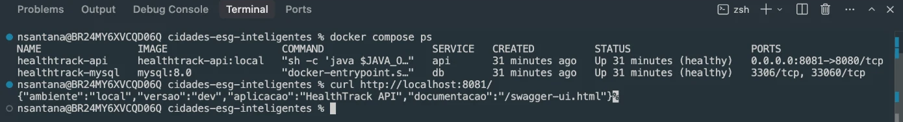

### 2. CI: build e testes automatizados no Pull Request
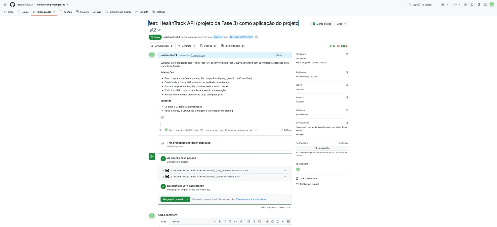

### 3. CD: testes, imagem Docker e deploy em staging
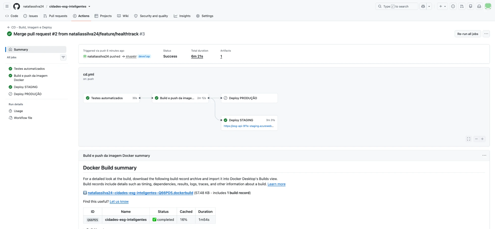

### 4. Release para produção com aprovação manual
Pull Request de release (`develop → main`), já com o deploy de staging concluído:
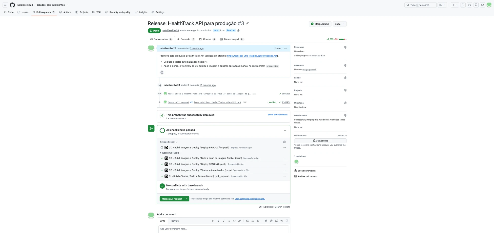

Pipeline aguardando aprovação do environment `production`:
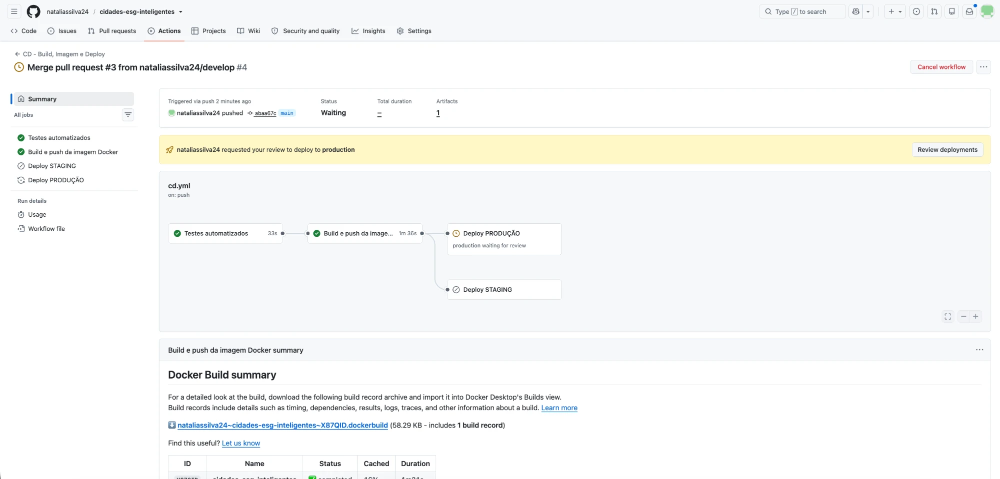

Revisão e aprovação do deploy:
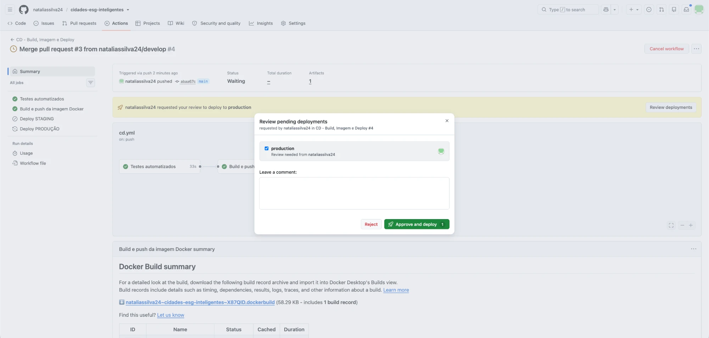
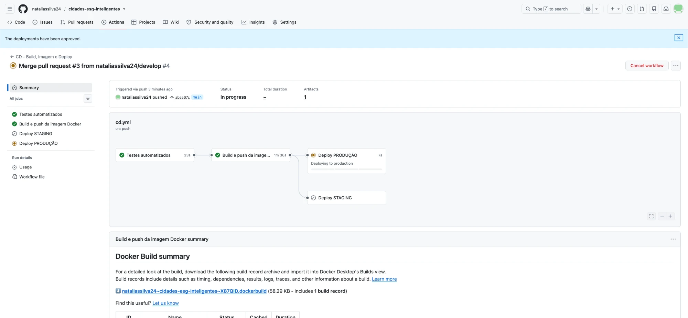

Pipeline de produção concluído:
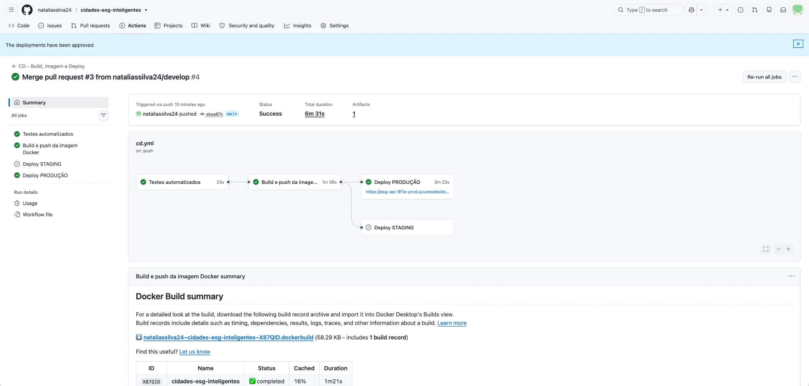

### 5. Ambiente de staging funcionando
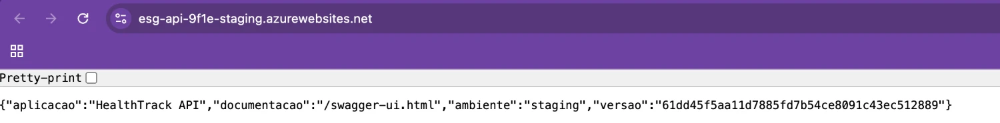
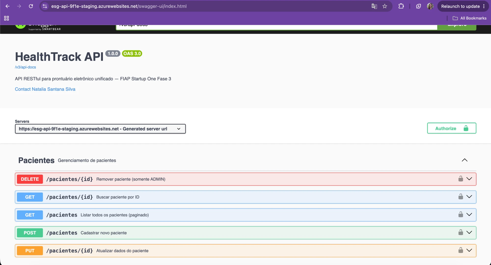

### 6. Ambiente de produção funcionando
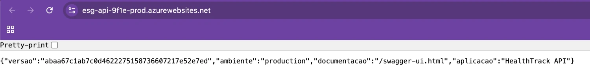
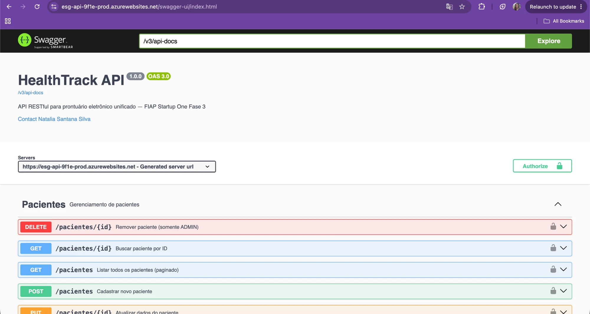

### 7. Recursos no Microsoft Azure
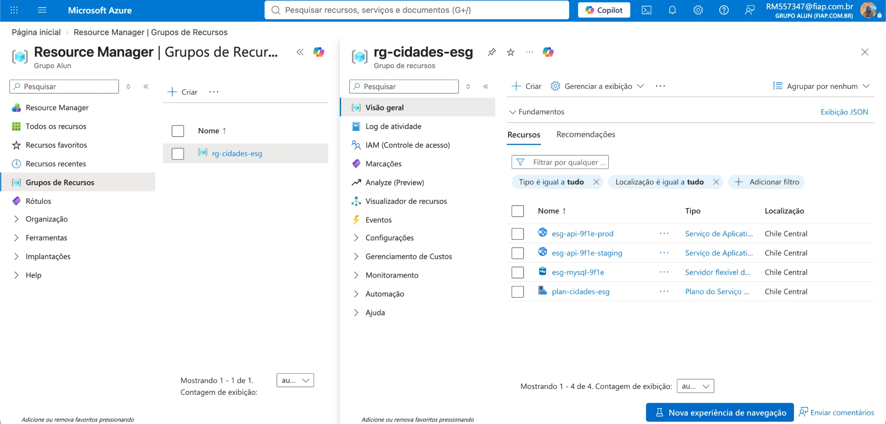

---

## Tecnologias utilizadas

- Linguagem e framework: Java 21, Spring Boot 3.2 (Web, Data JPA, Validation, Security, Actuator), JWT (jjwt), Lombok, springdoc-openapi (Swagger)
- Banco de dados: MySQL 8 (local via Docker e Azure Database for MySQL Flexible Server), Flyway (migrations)
- Testes: JUnit 5, Spring Boot Test, MockMvc, Mockito, Spring Security Test
- Build: Maven
- Containers: Docker (multi-stage), Docker Compose
- CI/CD: GitHub Actions, GitHub Environments (aprovação manual), GitHub Container Registry
- Nuvem: Microsoft Azure App Service (Web App for Containers, Linux B1), Azure Database for MySQL e Azure CLI

---

## Checklist de entrega

| Item | OK |
|---|---|
| Projeto compactado em .ZIP com estrutura organizada | ☑ |
| Dockerfile funcional | ☑ |
| docker-compose.yml ou arquivos Kubernetes | ☑ |
| Pipeline com etapas de build, teste e deploy | ☑ |
| README.md com instruções e prints | ☑ |
| Documentação técnica com evidências (PDF ou PPT) | ☑ |
| Deploy realizado nos ambientes staging e produção | ☑ |
